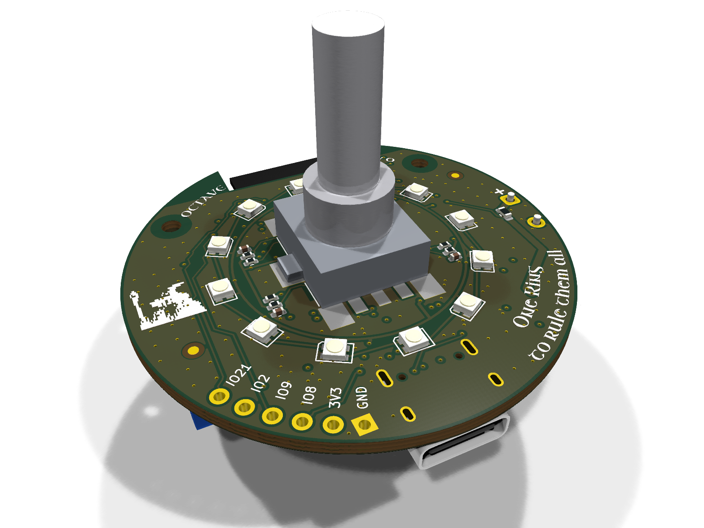

# OCTAVE wireless volume knob, Rev 0

A battery-powered knob for OCTAVE's volume: an ESP32-C3, a rotary encoder with a push switch, a ring of 12 addressable RGB LEDs and a rechargeable cell on a 47 mm round board. It talks ESP-NOW to the ESP32-S3 USB dongle OCTAVE already supports (`src/managers/esp32volumemanager.cpp`: `+N` / `-N` / `M` lines one way, volume, mute and colour the other), so the app needs no change. Built for a Jeep parked in Arizona: every part is rated to 80 C or more.

**Status:** generated, routed and checked by rule (ERC 0 errors, DRC 0 clearance errors, 0 unconnected, schematic and board agree), by two datasheet audits of the netlist, one review of the circuit and one of the routed layout, whose findings are fixed (see "What the reviews changed"). A third audit (five independent reviews against the makers' datasheets: pin numbers and land patterns, the power chain, the module and what firmware needs of it, the manufacturing files, the routed copper and the mechanics) found no wrong pin, footprint or rotation; what it changed is in the same section, and those last changes are themselves unreviewed. Not reviewed by a person, not ordered, no firmware. Read "Before ordering".



## What is on it

| Block | Part | Why this one |
|---|---|---|
| Cell | Nichicon SLB12400H1311CX, lithium titanate, 2.1 V 130 mAh, 12.5 x 40 mm | The only small rechargeable found that is rated for a hot car: -30 to 80 C, no thermal runaway, 20,000 cycles. A LiPo is rated to 60 C at best. Hand-fitted (not an LCSC part) |
| Charger | TI BQ25173-Q1, linear, set to 2.40 V and 150 mA | A charger whose voltage can be set under the cell's 2.5 V limit. About an hour for a full charge |
| Cut-off | TI TPS3840PL16 on the boost's enable | Stops the discharge at 1.6 V, back on at 1.7 V. The cell is rated to 1.5 V and rests at 1.98 V when empty, so only load on an empty cell trips it. The 1.8 V PL18 was the first choice: none in stock |
| 3.3 V | TI TPS61299 boost, 95 nA quiescent | The knob sleeps nearly all its life |
| Reset | TI TPS3840DL28 on the module's EN | The rail rises and falls slowly with the cell |
| MCU | ESP32-C3-MINI-1-H4X (105 C) | ESP-NOW, 5 uA deep sleep, flashes over its own USB |
| Encoder | Alps EC11J1525402, reflow mount, 30 detents, push switch | The 85 C encoder that leaves the back of the board flat for the cell |
| LEDs | 12 x WS2812B-2020-V6 behind a TPS22919 switch | The V6 runs from 3.3 V and draws under 1 uA dark |
| USB-C | HRO TYPE-C-31-M-12, USBLC6-2SC6 | Charging and flashing |

Top: the encoder in the centre, the LED ring at 14 mm radius, the encoder's pull-ups and filters in columns beside it and the cell's fuse; the ring's supply and data are wired by hand in `gen/prewire.py` (a supply ring inside the LEDs, the data chain outside). Bottom: the cell across the middle, wholly inside the outline at its largest tolerance (13 x 42 mm), every test pad, each LED's capacitor under its own LED (D10's is 7.5 mm away, the module is under that LED), the module above it with its antenna over a 16 mm notch cut in the rim, USB-C at the rim below with the charger on one side and the boost converter on the other. Four layers: signals, ground plane, signals, signals.

Expansion row: six plated holes (1.0 mm, 2.54 mm pitch, on an arc at the rim beside the USB socket) for wires, named on the top: GND (square pad), 3V3, IO8, IO9, IO2, IO21. The module has no unused pin, so these are the three strapping pins and the boot-log pin, free once it has started: IO8 and IO2 must not be held low at reset, IO9 low at reset is the ROM downloader, IO21 prints the boot log. Each of IO8, IO9 and IO2 has a 10k pull-up to 3V3 (IO8 and IO9 make an I2C bus as they are). 3V3 reaches its hole on 24 mm of 0.2 mm track: a sensor, not a motor. The holes follow the rim, so a straight 6-pin header does not fit them: wires, or two 3-pin headers (0.1 mm off, inside the holes' slack).

For the fun of it, on the top between the LED ring and the rim: the wizard of the terminal greeting (`gen/wizard.txt`, as on the OBD adapter, here 6.5 mm across: a cell is 0.13 mm, so it is a silhouette with no shading and its finest specks may not print), "One Ring to rule them all" round the lower right of the ring of LEDs, OCTAVE and Rev 0 either side of the antenna notch, in Uncial Antiqua (SIL Open Font License). The font is not in the repo: `gen/mkart.py <font.ttf>` wrote the letters' outlines to `gen/art.json` once; `gen/art.py` says where each goes and bends it round the centre.

Pins: GPIO0 encoder A (wake), 1 encoder B (wake), 3 switch (wake), 4 cell voltage (ADC), 5 USB present (wake), 6 LED data, 7 charger /CE, 10 LED rail enable, 20 charger STAT, 18 / 19 USB, 2 / 8 / 9 strapping (pulled up; 9 is BOOT), 21 boot log on a test pad.

## Files

| Path | What |
|---|---|
| `gen/knob.py` | **The design.** Every part, its LCSC number, its pin-to-net map, and the notes on why. Edit this, not the KiCad files |
| `gen/parts.py` | LCSC part numbers, checked against JLCPCB's library on 2026-11-22 |
| `gen/libdefs.py` | Symbols KiCad does not ship (the module, the charger, the boost, the supervisors, the load switch) |
| `gen/layout.py` | Placement: fixed positions for what matters, a packer for the rest |
| `gen/prewire.py` | Copper laid by hand before the autorouter: the boost converter's loops, the cell's feed, the module's ground |
| `gen/routing.json` | The routed copper, frozen. `build.py route` replays it |
| `gen/jlc_corr.py` | Rotation / offset of each part in JLCPCB's placement file, fitted to JLCPCB's own footprints, and the rule for bottom-side parts |
| `gen/art.py`, `gen/art.json`, `gen/wizard.txt`, `gen/mkart.py` | The wizard, the quote and the name on the top silkscreen |
| `gen/mk3d.py` | Plain 3D shapes for the cell with its bent leads, the module, the encoder and the LEDs (for the renders only); every part but the test pads, fiducials and holes has a body |
| `gen/build.py` | Regenerates everything (below) |
| `lib/OCTAVE.pretty` | Footprints drawn from the makers' land patterns: the module, the encoder, the boost's WCSP, the cell |
| `volume-knob.kicad_sch` / `.kicad_pcb` | Generated KiCad 10 project |
| `fab/` | Generated: Gerber zip, JLCPCB BOM and CPL, the hand-fit list |
| `renders/` | Generated pictures of the board |

```bash
cd hardware/volume-knob/gen
python3 build.py sch      # symbols, schematic, ERC
python3 build.py pcb      # board with placement
python3 build.py route    # replays gen/routing.json, pours, DRC
python3 build.py fab      # Gerbers, drill, BOM, CPL, renders
python3 build.py all
```

Use the system `python3` (KiCad's `pcbnew` module lives there). To route again after moving parts: `KNOB_REROUTE=1 python3 build.py route` (Freerouting 2.5, about 5 minutes; `FREEROUTING_JAR` to point at the jar). It lays the hand copper and a via for every ground pad, runs Freerouting on the signals, finishes any leftover with the grid router (`maze.py`), stitches the ground pours and freezes the result. Freerouting does not give the same answer twice: check `drc.rpt` after every fresh route.

## What DRC still says

- **NPTH inside courtyard (2):** the encoder's centre boss and locating pin come through the board under the cell. They stop 0.4 mm short of the far side of a 1.6 mm board. Do not order it thinner.
- **Footprint does not match library (6):** silkscreen that reached over the board edge was removed on the board, and the boost converter's lands have a smaller mask margin.

The board is 47 mm because that is the smallest disc that holds the cell at its tolerance with the module's antenna at the rim. Only 0402 parts sit under the cell's flanks (0.55 mm tall, 1.2 mm of air), nothing under its centre line.


## What the reviews changed

- **Circuit review:** the cut-off raised from 1.6 V to 2.0 V with a filtered supply; a reset supervisor on the module's EN; the USB ESD array's rail taken off VBUS; the USB-present divider changed so 4.4 V reads as a high; a fuse at the cell; the charge current lowered to 150 mA; a pull-down on the LED data line.
- **Layout review:** the boost's output capacitor now returns to the converter's one ground ball (it had been wired to the VSEL ball beside it); no via within 0.15 mm of any solder pad; no copper on any layer beside or under the antenna, rim to rim; 3.3 V goes from the boost to the module on a 1 mm trunk with two vias at each end; no pour under the screw heads or under the boost converter; fiducials on both sides; names at the test pads where there was room.
- **Second layout review and a manufacturing review (of the 47 mm board):** the cut-off lowered from 2.0 V to 1.8 V (2.0 V is inside the flat bottom of the cell's curve: radio activity could trip it from 10 to 30 % charge, and it would stay off until charged); two ground vias that cut into the USB shell's slots removed; the cell-voltage track that ran under the USB shell moved to an inner layer; the ground via in C21's pad removed (C8 shares C7's); a supply via of their own for the capacitors of D2 and D6; no drill map in the gerber zip. Footprints, pin numbering, the placement file's rotation rule, the boost's loop, the ground plane and the antenna strip were checked and found right.
- **Third audit (five reviews against the datasheets):** no wrong pin number, land pattern, LCSC number or placement rotation. Changed: the encoder's filter capacitors from 2.2 nF to 220 pF (with the 1M pull-up an opening contact took 3 ms to read high, as long as the wake from deep sleep, and the direction of the first click hangs on reading B before the detent); the switch's pull-up from 100k to 33k (Alps' minimum current for the switch is 0.1 mA); the cell-voltage resistor from 1M to 470k (pin leakage through 1M was up to 50 mV of error against a 70 mV-wide guard); the cut-off to the 1.6 V part (the 1.8 V one has no stock at JLCPCB); the board cut away under and beside the antenna (Espressif's rule when the antenna does not overhang the edge); the encoder's locating hole from a 1.6 x 1.9 mm slot to a 1.9 mm round hole (JLCPCB wants a slot twice as long as wide).
- **Left after the third audit, knowingly:**
  - The USB socket's mouth is level with the rim (HRO draws it 0.5 mm proud). A plug seats on the bare board; the housing needs an open pocket for the plug's overmould (13 x 7 mm) down to the board, no wall in front of the socket. Moving the socket out means routing USB again.
  - BOOST_EN runs on the second inner layer for 1 mm under the boost converter's balls and the corner of the inductor's pad. The converter's output loop still has ground under it.
  - The charger's branch of VBAT is 0.2 mm wide; the 3 A fuse does not protect it against a short at the charger. Normal current there is 150 mA.
  - CHG_STAT is on U0RXD with no pad: there is no UART download path, only USB. Whether the ROM downloader minds that line low (a full cell on USB) is not known; hold GPIO20 low on a dev board and run esptool over USB to find out.
  - Silkscreen names are 0.8 mm high with 0.12 mm strokes, under JLCPCB's stated 1.0 / 0.15: they may print faint.
  - IO2's track runs beside LED_DATA for 7 to 10 mm: not for an analogue input while the LEDs are being written.
- **Left after the earlier reviews, knowingly:**
  - The capacitors of D8, D9, D10 and D11 reach their LED through 18 to 39 mm of track (no room for a via beside them; the nearest capacitor of any LED is within 20 mm). The LEDs should work; watch for flicker on those four first.
  - The USB-power link between the socket's two VBUS pads and three signal vias (CC1, CC2, D-) are on the bottom within 1.9 mm behind the socket's pad row, under its rear, with solder mask between. There is no room in front of the pads. A short there stops USB, it does not reach the cell.
  - EN crosses between the module's ground pads under the module with a 0.19 mm gap.
  - The charger's output capacitor is 11 mm of 0.2 mm track from the pin; the cell is on the same node.
  - Ground pours join 0402 pads solidly (spokes left pads cut off in the tight spots): a small tombstoning risk on 28 parts. Look at them on the first boards.
  - Nothing protects against a cell soldered backwards.
- **Left as found:** D+ reaches the ESD array on a 2 to 4 mm stub (D- runs through it); it is full-speed USB.

## What the firmware must do

There is none yet. The knob-side and the dongle-side firmware are not in this repository; the knob's has to match whatever the dongle speaks. From the reviews, the hardware assumes:

- **Sleep:** deep sleep, wake on GPIO0 and GPIO1 (level, each set to the opposite of its contact's level before sleeping), GPIO3 (low) and GPIO5 (high; while USB is in, arm it for low). Before sleeping, turn on the internal pull-up of A or B where its contact is open now (it costs nothing and holds against hot leakage) and leave it off where it is closed. `CONFIG_ESP_SLEEP_GPIO_ENABLE_INTERNAL_RESISTORS` off: the board has its own pull-ups.
- **First click:** A switches halfway between detents and B switches at the detents, so waking on A and then reading B races the detent, and loses in one direction on some units. Wake on both. Keep the last A and B in RTC memory, read both in a deep-sleep wake stub (2.7 ms after the edge) and decode the quadrature there: the line that moved first gives the direction, and if both have moved, it was the direction in which A moves first (the other would have woken the knob 6 degrees earlier). Stay in the stub until the knob has been still for 30 ms, then boot: the C3 has no pulse counter, and steps turned during a 200 ms boot are otherwise lost. If B chatters at rest in a moving car and wakes the knob for nothing, drop B as a wake source for that sleep. Awake, turn on the 45k pull-ups and debounce in software (Alps: 3 ms of chatter).
- **LED data pin:** GPIO6 has a pull-up at reset. Before sleeping: drive it low, pull-up off, hold it (`gpio_hold_en`). Hold LED_DATA low before LED_EN goes low. Wait 5 ms after LED_EN before sending data.
- **LED current:** the ring is 432 mA at full white, more than the boost has. A WS2812 dims by switching its full 12 mA on and off, so the limit is on channels lit, not on brightness: at most 8 colour channels lit at once, at most 2 (or dark) while the radio transmits.
- **Cell:** read VBAT before starting the radio; below 2.05 V go back to sleep. This is what stops an empty cell from boot-looping: the hardware cut-off at 1.6 V lets the boost back on at 1.7 V, and an empty cell rests above that. The reading is good to about 60 mV: add hysteresis and expect the guard to trip early. On USB with an empty cell, wait for 2.1 V before starting the radio (the charger's 150 mA cannot carry a transmit burst). If VBAT ever reads over 2.5 V, raise CHG_CE. The voltage says little between 10 and 90 % (140 mV in all); calibrate the reading per unit.
- **Charging:** the charger holds 2.40 V for as long as USB is in. Stay awake (or wake on a timer) while GPIO5 is high; raise CHG_CE when STAT has been low for a while, or above about 60 C on the chip's own sensor. Never sleep with USB in if the knob is to be flashed: the USB device disappears in deep sleep.
- **Switch:** require a 30 to 50 ms hold before acting; a hard bump can trip it.
- **Recovery:** short the BOOT pad to ground and tap EN to ground for the ROM downloader. Those pads are on the cell side, inside the housing: have the firmware stay awake with USB up when the switch is held at power-on, so a bad build can be reflashed with the housing closed.

## Before ordering

1. **The cell's leads may not reach.** Nichicon's one-page sheet draws 3.5 mm leads; its product page gives the 1CX suffix as leads cut to 15 mm, which would reach (the path lying flat is about 10 mm). Look at the part in hand. If they are short, fit the cell on stranded tails (24 AWG fits the 1.1 mm holes), soldered with a heat sink on the lead; they also take vibration better than a rigid lead. Trim the joints flush on the top (they are otherwise taller than the LEDs), and keep the iron brief at the + hole, the fuse is 2.8 mm away. Either lead can go in either hole by rolling the can: the + lead goes to the hole marked + (square pad).
2. **Order options.** ENIG finish (the boost converter's lands are 0.2 mm at 0.4 mm pitch; ask what stencil thickness they will use, TI assumes 0.075 mm). Panelised with rails (their assembly needs at least 70 x 70 mm); tabs only at 15 to 70 and 115 to 200 degrees (clockwise from +x, y down), never at 248 to 292 (module), 73 to 107 (USB) or 350 to 12 (cell pad). File the tab stubs. Ask for the top side (the encoder, with its long shaft) to be reflowed last.
3. **The housing and the cell.** The cell no longer overhangs: its far corner is 0.3 mm inside the edge at the largest tolerance, so the housing follows the board, about 48 mm inside. The cell is 9.2 g on two leads: put Kapton or 85 C foam tape between the can and the board (vias and three tracks run under its contact line, and the can's polarity is not documented) and hold it with a cradle or RTV. Mark + on the sleeve before fitting: rolled over, it is reversed. The board is screwed down at two points on one side only: give the housing a ledge under the whole rim, most of all at the USB end and around the encoder, without pressing on the cell. Screw bosses 5 mm across at most (C11 is 2.8 mm from one hole's centre). No metal in the cap over the antenna end. Take the shaft length for the cap from the part, not from the render. Leave the vent (the end away from the leads) clear of the wall, and print in ASA or better.
4. **JLCPCB's placement preview.** `gen/jlc_corr.py` was fitted numerically but its rule for bottom-side parts has not been through a real order, and 55 of the 78 placed parts are on the bottom. Check any bottom IC first, then J1, U4, U2, U6, D1 to D12 and SW1.
5. **The boost converter's package.** A 6-ball WCSP at 0.4 mm pitch with 0.2 mm lands: confirm JLCPCB's assembly takes it on this order. The SOT-563 version (C41689719) had 19 in stock.
6. **Stock.** The cut-off is the 1.6 V TPS3840PL16 (C1852124, 179 on 2026-11-22) because the 1.8 V PL18 (C1852123) had none; either fits the pads. U7 (C2066416) had 557, the encoder 1,393: check all three again on the day. The encoder is "not recommended for new designs" at Alps; JLCPCB had 1,398.
7. **Ask Nichicon** for the full specification of the H131: charge-voltage tolerance, whether it may float at 2.4 V at 80 C, self-discharge, soldering limits. The public datasheet is one page.
8. **Rated to 80 C, not 85:** the cell and the USB socket; the fuse to 90 C. **Things to measure on the first board:** radio range (the cell's steel can is about 10 mm from the antenna, Espressif asks for 15), the LEDs' blue at 3.3 V (the bottom of their range), sleep current (estimate: about 16 uA from the cell at 25 C, three to four times that held at 85 C), the 3V3 dip on a transmit burst, whether the ROM downloader minds CHG_STAT low on U0RXD.
9. **First power-up, before the cell goes in.** Hold the BOOST_EN pad (BEN) to ground with a clip, plug USB in, and measure the VBAT pad: 2.40 V. If the 200k feedback resistor (R9) has an open joint the charger drives VBAT to 5 V, and the boost converter passes anything above 3.4 V straight through to the module: with BOOST_EN grounded nothing reaches it. Only then fit the cell, the + lead found with a meter (the leads are the same length).
10. **Tell JLCPCB:** solder the USB socket's four shell legs (the stock footprint puts no paste on them; otherwise solder them by hand, they carry the plug's force); keep the solder mask web between the boost converter's six lands; green mask (black and white need a wider web than the 0.14 mm there). In their viewer, the layer with no tracks is inner layer 1.
11. **Worth a breadboard before ordering:** an EC11J on a C3 dev board with 1M pull-ups, 1k and 220 pF, waking from deep sleep on both lines: count wrong first clicks in both directions. It is the one behaviour the reviews could not settle on paper. If it cannot be made reliable, the fix is a small latch on B, and the pins it would need are the ones on the expansion row.
12. **Storage.** Below the cut-off about 3 uA still leaves the cell (mostly through the voltage-sense resistor into the unpowered module): left empty for months it goes under its 1.5 V rating. Charge it before putting it away, and add "how long at 0 V" to the questions for Nichicon.
13. Nylon screws at the two mounting holes (they are 7 mm from the antenna); their heads are taller than the LEDs.
14. With no cell fitted the knob boot-loops on USB alone (the charger's 150 mA cannot carry a transmit burst): bring it up with the cell in, or a bench supply on the VBAT pad.

## Why some things are the way they are

- **No LiPo, no fast charge.** The cell takes 20C, but a linear charger dropping 3 V in a sealed knob does not: 150 mA keeps it at half a watt. A buck charger would charge in minutes and is the obvious Rev 1 change.
- **The encoder leaks.** Every 85 C encoder found has 15 pulses for 30 detents, so one contact rests closed half the time: 3.3 uA through its 1 M pull-up. The both-open kind is 70 C.
- **3.3 V and nothing higher.** The boost's 3.5 V setting plus its tolerance is over the module's 3.6 V maximum.
- **The USB ESD array's rail pin is not on VBUS.** On VBUS, the module's D+ pull-up would lift the USB-present sense through the array with no cable in.
- **Ground vias before signals.** Routed the other way round, some ground pads ended up boxed in with no room for a via.
